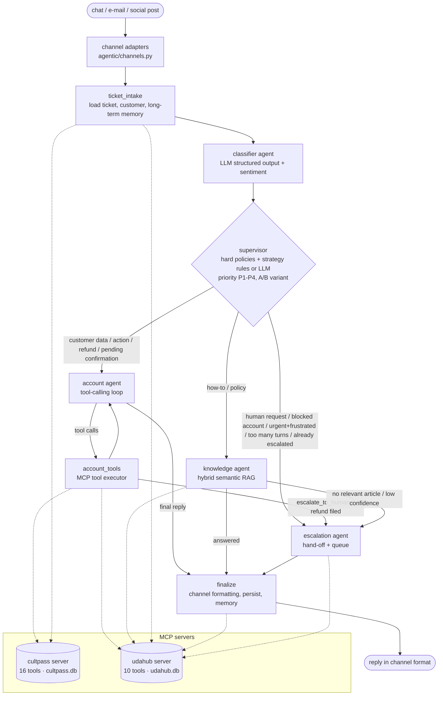

# UDA-Hub: Agentic System Design

UDA-Hub is a multi-agent customer-support system. Its first client account is **CultPass**, a subscription
for cultural experiences in Brazil. Tickets arrive by chat, e-mail or social media. The system classifies
each one, gives it a priority, and routes it to a specialist agent. That agent resolves the ticket from the
knowledge base (semantic RAG), resolves it with account tools (CultPass DB through MCP), or escalates it to
the right human queue with a hand-off note. Every decision is persisted and logged.

## 1. Architecture

The orchestration pattern is **supervisor / router with specialist workers**. It's a hand-built
`StateGraph` in `agentic/workflow.py`. It doesn't use the prebuilt ReAct agent or `langgraph-supervisor`.



### Agents and nodes

| Node | File | Type | Responsibility |
|---|---|---|---|
| `ticket_intake` | `agents/ticket_manager.py` | deterministic | Treats `thread_id` as the ticket ID. Creates the ticket if it's new, or loads it and its earlier messages. Works out the channel, logs the user message, loads the CultPass profile and recalls long-term memory. Resets per-turn state, and carries a pending confirmation over one turn. |
| `classifier` | `agents/classifier.py` | LLM (structured output) | Produces a `TicketClassification`: category (11 types), urgency, **sentiment**, confidence, a summary used as the search query, tags, and stated customer preferences. Has a keyword fallback if the LLM fails, a hard guardrail for explicit "talk to a human" requests, and treats platform urgency as a minimum. |
| `supervisor` | `agents/supervisor.py` | deterministic or LLM (A/B) | Applies the **hard policies** first, then a routing **strategy**: `rules` or `llm`, chosen per ticket by the A/B framework (§9). Computes the **priority** (§8). |
| `knowledge_agent` | `agents/knowledge.py` | LLM + RAG | Retrieves articles (hybrid TF-IDF and embeddings), answers only from them, and reports whether they were enough to answer. Escalates when retrieval is weak or the answer has low confidence. Also handles `closing` turns. |
| `account_agent` | `agents/account.py` | LLM tool-calling loop | Its first step each turn **must** be a tool call (`tool_choice="required"`), so it can't answer from memory. The help-centre articles relevant to the message are injected into its prompt (the same retrieval as the knowledge agent), and policy answers must come only from them. It reads and changes customer data through 16 tools bound to the customer (§7): profile, reservations, experiences, subscription management, refunds, profile and e-mail changes, knowledge search, past tickets, `escalate_to_human`. |
| `account_tools` | `agents/account.py` | deterministic | A custom tool executor that runs tool calls through MCP and logs each call with its outcome. It enforces two policies in code: a filed refund always escalates, and a previewed change becomes a `pending_action`. |
| `escalation_agent` | `agents/escalation.py` | LLM (structured output) + template fallback | Writes an internal hand-off note on the ticket (summary, priority, recommended action, **queue**) and an empathetic message to the customer. Picks the human queue: `billing`, `trust_safety`, `technical` or `general`. High urgency is never downgraded. |
| `finalize` | `agents/ticket_manager.py` | deterministic | Formats the reply for the channel, then persists the reply and the ticket's status, issue type, tags, priority and queue. Writes long-term memory. |

### State (`agentic/state.py`)

- **Conversation:** `messages`, using the `add_messages` reducer and persisted by the checkpointer.
- **Identity:** `ticket_id`, `account_id`, `external_user_id`, `turn`, `ticket_status` and `channel`.
- **Input metadata:** `ticket_metadata`, for example `{"channel": "email", "urgency": "high", "sender": ...}`.
- **Context:** `customer_context`, `long_term_memory` and `prior_ticket_messages`.
- **Per-turn working fields:** `classification`, `route`, `route_reason`, `priority`, `experiment`,
  `retrieved_articles`, `scratchpad` (the tool loop, kept out of the customer-facing history),
  `escalation_reason`, `resolution`, and `pending_action` / `awaiting_confirmation` for two-step changes.
- **Observability:** `trace`, an append-only list of every decision.

## 2. Inputs and expected outputs

**Input (one graph invocation = one customer message).** Either build it yourself or use a channel
adapter: `from_chat(text, user_id)`, `from_email(sender, subject, body)` or `from_social(handle, text)`.

```python
{
  "messages": [HumanMessage("...")],          # natural-language ticket text
  "external_user_id": "f556c0",               # CultPass customer; only needed on a new ticket
  "ticket_metadata": {"channel": "email",     # chat | email | social
                      "urgency": "high"},     # optional: minimum urgency set by the platform
}
config = {"configurable": {"thread_id": "<ticket id>",
                           "routing_strategy": "rules"}}  # optional: rules | llm | ab
```

**Output:** the final graph state. The customer reply is `state["messages"][-1]`, formatted for the
channel, with `name` set to the agent that wrote it. The state also holds `classification`, `route`,
`route_reason`, `priority`, `experiment`, `resolution` and `trace`. As side effects:

- the ticket's messages, status, issue type, tags, priority and queue are written to `udahub.db`;
- account actions change `cultpass.db`;
- memories are saved;
- events are logged.

| Input type | Example | Path | Expected output |
|---|---|---|---|
| How-to / policy question (including paraphrases) | "There is no code to scan in my ticket" | knowledge agent | Answer grounded in the matching article(s); `resolved` |
| Question with no matching article | "Recommend a pizza recipe" | knowledge agent → escalation | Hand-off; `escalated`, queue `general` |
| Needs customer data | "Which reservations do I have?" | account agent ⇄ tools | Answer from live CultPass data; `resolved` |
| Action request | "Book Samba Night at Lapa" | account agent → `search_experiences` → `reserve_experience` | Confirmation with reservation ID, and the DB updated; or the business-rule reason |
| Subscription change | "Pause my subscription" → "yes" | account agent, two turns | Turn 1: preview, `in_progress`. Turn 2 (routed by the pending action): executed, `resolved` |
| Refund | "I was charged twice" | account agent → `request_refund` → escalation | Refund `pending_approval`; `escalated` to `billing`; a human decides with `decide_refund` |
| Profile / e-mail change | "Change my name to …" | account agent → `update_my_name` / `request_email_change` | Updated, or a verification link sent |
| Blocked account wants access | "I can't log in" (blocked) | policy → escalation | `escalated` to `trust_safety` |
| Late cancellation (<24h) | "Cancel my event in 3 hours" | account agent → tool refusal → `escalate_to_human` | `escalated` |
| Human request / angry / urgent and frustrated / long ticket | "Let me talk to a human" | escalation | `escalated`, high priority |
| E-mail | sender `bob.stone@granite.com` | adapter identifies Bob; strips quotes and signature | E-mail-style reply with greeting and sign-off |
| Public social post | "@cultpass app crashed!!" | adapter (customer not identified) | ≤280 characters, no personal data, invitation to DM |
| Follow-up in the same ticket | "Thanks, that's all!" | short-term memory | Closing message; `resolved` |
| Returning customer | Bob, new ticket | long-term memory recall | Reply personalised with past interactions and preferences |

## 3. Ticket lifecycle

The statuses are `open`, `in_progress`, `resolved` and `escalated`:

- A new ticket is `open`.
- An AI answer makes it `resolved`. A previewed change waiting for the customer's confirmation keeps it `in_progress`.
- A hand-off makes it `escalated`, with a priority (P1–P4) and a queue.
- A customer writing again on a `resolved` ticket reopens it as `in_progress`.
- An `escalated` ticket stays with the humans: later messages are added to its hand-off.

Human staff work the queue with the staff MCP tools `list_tickets` (most urgent first) and `assign_ticket`.

## 4. Routing (supervisor)

**Hard policies** apply to every strategy, in this order:

| # | Condition | Route |
|---|---|---|
| P1 | ticket already `escalated` | escalation |
| P2 | category `human_request` | escalation |
| P3 | CultPass account blocked **and** category `login_access` / `account_status` | escalation (the AI can't unblock; trust & safety reviews) |
| P4 | category `billing_refund` | account agent, which files the refund request; the executor then escalates to billing. If the customer is unknown, straight to escalation. |
| P5 | a change was previewed last turn and is awaiting confirmation | account agent |

**Strategy `rules`** (default), where the first match wins:

| # | Condition | Route |
|---|---|---|
| R1 | `complaint` with negative or angry sentiment, or high urgency | escalation |
| R2 | **angry** sentiment **and** high urgency (any category except `closing`) | escalation. A merely *negative* customer only gets a higher priority, and the AI still tries first. |
| R3 | more than 5 turns on the ticket (complexity) | escalation |
| R4 | `reservation`, `subscription`, `account_status`, `experience_info` | account agent |
| R5 | classifier confidence < 0.35 | knowledge agent, which escalates if nothing relevant is found |
| R6 | everything else | knowledge agent |

**Strategy `llm`:** a structured-output LLM router (`RouteDecision`) picks the route from the classification,
ticket metadata and customer context. If it fails, the supervisor falls back to `rules`.

Agents can also escalate later in the turn:

- The knowledge agent escalates on low retrieval relevance, an answer the LLM marks as not answerable, or answer confidence below 0.5.
- The account agent calls `escalate_to_human` for late cancellations or repeated tool failures, and is forced to escalate after 6 tool rounds.
- Every refund request is escalated by the executor, in code.

## 5. RAG (knowledge retrieval)

- **Corpus:** the `knowledge` table (16 CultPass articles). It's scoped by `account_id`, so each client account gets its own knowledge base.
- **Hybrid semantic search:** `HybridRetriever` in `tools/retrieval.py`.
  - **Lexical part:** TF-IDF cosine similarity with stop-word removal and light stemming. Documents are weighted as title ×3, tags ×2 and content ×1.
  - **Semantic part:** OpenAI `text-embedding-3-small` cosine similarity.
  - **Score:** `0.25 × TF-IDF + 0.75 × embedding`. This blend was chosen by sweeping weights over labelled
    queries: 20 of 21 queries got the right article first, and the lowest relevant score (0.234) stayed
    above the highest off-topic score (0.170).
  - **Default:** embeddings are on whenever an API key is configured (`UDAHUB_EMBEDDINGS=auto`). Without a key, retrieval falls back to TF-IDF only.
- **Vector store:** article vectors are kept in the `knowledge_embeddings` table, keyed by article and
  model, with a content hash. Only new or edited articles are re-embedded. Notebook 02 builds the store,
  and the in-process index cache is rebuilt when articles change.
- **Mode-specific relevance thresholds:** hybrid 0.20, lexical 0.15. `search_knowledge` reports its mode and threshold.
- **Generation:** hits scoring at least `max(threshold, 0.5 × top score)` go into the knowledge agent's
  prompt, which must answer *only* from them. The answer is a `KnowledgeAnswer` with `answerable`,
  `confidence` and `used_article_titles`. It escalates if `answerable` is false or confidence is below 0.5.
- **Calibration tests:**
  - `tests/test_retrieval.py` (lexical, offline) checks that 16 queries return the right article first and that off-topic queries fall below the threshold.
  - `tests/test_live_llm.py::test_live_hybrid_retrieval_calibration` (hybrid) also checks that paraphrases find their article in the top 3, and that vectors are persisted.

## 6. Memory

| Kind | Mechanism | Scope |
|---|---|---|
| **Short-term (session)** | LangGraph checkpointer (`InMemorySaver`) keyed by `thread_id` = ticket ID. It holds the full state across turns, including any pending confirmation. | one ticket / conversation |
| **Ticket history** | `ticket_messages` in `udahub.db`. When a conversation starts on an existing ticket, its earlier messages are loaded into `prior_ticket_messages`. | one ticket, across processes |
| **Long-term** | `customer_memories`. `finalize` writes an **interaction** summary each turn (category, summary, outcome, actions) and any **preferences** the classifier extracted (deduplicated). `ticket_intake` recalls all preferences plus the most relevant interactions, which are injected into every agent prompt. | customer, across tickets and sessions |

## 7. Tools and MCP

All database access goes through two **FastMCP servers** (`tools/mcp_servers/`). Each tool is tagged by
who may use it:

| Server | Tag | Tools |
|---|---|---|
| `cultpass` | customer | `get_customer_profile`, `list_reservations`, `search_experiences`, `reserve_experience`, `cancel_reservation`, `pause_subscription`, `resume_subscription`, `cancel_subscription`, `change_subscription_tier`, `request_refund`, `list_refund_requests`, `update_profile`, `request_email_change` |
| `cultpass` | staff | `find_customer`, `decide_refund`, `set_account_block` |
| `udahub` | platform | `search_knowledge`, `get_ticket`, `create_ticket`, `add_ticket_message`, `update_ticket_metadata`, `get_customer_ticket_history`, `save_memory`, `search_memories` |
| `udahub` | staff | `list_tickets` (work queue, most urgent first), `assign_ticket` |

Design principles:

- **Business rules live in the tools, not in prompts.**
  - Bookings: a blocked account can't book, an active subscription is required, premium experiences need the premium tier, slots and monthly quota are enforced, duplicate bookings are rejected, and cancellations need at least 24 hours' notice.
  - Plan changes: the tier name is validated, and a downgrade is refused while upcoming premium bookings exist.
  - Refunds: the reason and amount are validated, duplicates are rejected, and a request is only ever `pending_approval`.
  - E-mail changes: the address is validated, must be unique, and only changes after verification.

  When a rule fails, the tool returns `{"ok": false, "error", "message"}`, so the agent can explain what happened.
- **Two-step confirmation for changes the customer would regret:** pausing, resuming or cancelling a
  subscription, and changing the plan. A call with `confirm=false` only returns a preview. The AI may call
  with `confirm=true` only after the customer confirms in a later message. That confirmation reaches the
  account agent through the P5 policy.
- **Separation of duties:** the AI only receives customer tools bound to the ticket's customer (`tools/agent_tools.py`, with no `user_id` parameter). Staff tools are never given to the AI.
- **Transports and paths:**
  - `call_tool()` uses the in-memory MCP transport by default, or **stdio** with `UDAHUB_MCP_TRANSPORT=stdio`.
  - `mcp_servers_config()` provides the configuration for `langchain-mcp-adapters` or other MCP hosts.
  - DB paths are absolute, resolved in `agentic/config.py`.

## 8. Sentiment analysis and priority

The classifier extracts `sentiment` (positive, neutral, negative or **angry**) and `urgency`. `angry` is
reserved for explicit anger, and a calm problem report is `negative`. A deterministic guardrail upgrades
the label to `angry` when the text contains strong anger markers ("ridiculous", "unacceptable", "worst",
"!!" and similar), because live runs showed the LLM under-rating them. `compute_priority` in
`agents/supervisor.py` combines them into a score:

| Factor | Points |
|---|---|
| urgency | high 3, medium 2, low 1 |
| angry sentiment | +3 |
| negative sentiment | +2 |
| positive sentiment | −1 |
| premium customer | +1 |
| urgency set by the platform | +1 |
| money or account access at stake (`billing_refund`, `account_status`) | +1 |

The score maps to **P1** (6 or more), **P2** (4–5), **P3** (2–3) or **P4** (below 2).

Sentiment drives behaviour in three places:

- **Routing:** an angry customer with an urgent issue goes straight to a human (R1, R2). A merely negative
  one is answered by the AI first, but at a higher priority. This distinction came from reviewing the live
  runs: a calm "there's no code to scan at the door" was being sent to a human even though the help-centre
  article answers it immediately.
- **Escalation priority:** high urgency is never downgraded.
- **Staff work queue:** `list_tickets` sorts by priority.

The priority and the factors behind it are logged with each routing event.

## 9. A/B testing of routing strategies

- **Strategies:** `rules` (deterministic) and `llm` (LLM router). Both sit behind the same hard policies.
- **Assignment:** `agentic/experiments.py` handles it, via `routing_strategy` in the config or
  `UDAHUB_ROUTING_STRATEGY`. Setting it to `ab` hashes each ticket ID 50/50, and the variant sticks for the
  whole ticket. The variant and the strategy actually used are logged with every routing event.
- **Online metrics:** `ab_report()` joins the logged variants with ticket outcomes to give, per variant: tickets, resolution rate, escalation rate, turns per ticket, tool calls per turn and route mix.
- **Offline evaluation:** `python -m agentic.evaluation` replays `data/evaluation/labelled_tickets.jsonl` through each strategy.
  - **Dataset:** 24 tickets covering every category and channel. Each ticket lists its acceptable routes and statuses.
  - **Isolation:** each strategy runs on a sandboxed copy of the databases.
  - **Metrics:** routing accuracy, outcome accuracy, escalation rate, tool calls and latency.
  - **Results:** in [ab_test_report.md](ab_test_report.md).
- **Findings:**

  | Run | `rules` fully correct | `llm` fully correct | Avg latency (`rules` / `llm`) |
  |---|---|---|---|
  | 1, before policy P3 | 95.8% | 83.3% | 5.3 s / 6.9 s |
  | 2, after policy P3 ([report](ab_test_report.md)) | 91.7% | 91.7% | 6.3 s / 8.3 s |

  - Run 1 showed the `llm` router sending blocked customers to the account agent, which explained the
    block instead of escalating it. That led to hard policy **P3**, which applies to every strategy.
  - In run 2 the strategies tie on accuracy, and `rules` is about 25% faster with one LLM call fewer per
    ticket, so it **remains the default**.
  - They err differently: `llm` sent "events in São Paulo" to the knowledge base, while `rules` sent
    "experiences left this month" there.
  - Repeated runs differ by ±1 ticket because of the model's variability in the downstream agents. On a
    24-ticket set that is within noise, and live `ab` traffic with `ab_report()` would be needed to separate the strategies.

## 10. Multiple channels

`agentic/channels.py`:

- **Inbound:**
  - E-mail: the customer is identified by the sender address (through `find_customer`); quoted replies and signatures are stripped; the subject is kept.
  - Social media: @mentions are stripped, and the customer is *not* identified, because the post is public.
  - Chat: the logged-in customer ID is passed through.
- **Generation:** each agent prompt gets a style rule for the channel (chat short; e-mail in paragraphs; social at most 2 sentences with no personal data).
- **Last-mile formatting in `finalize`:**
  - E-mail gets a greeting and a sign-off.
  - Social replies have e-mail addresses and IDs redacted, are capped at 280 characters, and invite the customer to send a DM.
- The channel is stored on the ticket, logged, and kept for every later turn.

## 11. Observability

Every node calls `log_event(...)` (`agentic/logging_utils.py`). Each event is one JSON line in
`logs/agent_events.jsonl` and is also added to `state["trace"]`. Event types:

- `intake`, with the turn, channel metadata and number of memories recalled
- `classification`, with its source (LLM, heuristic or guardrails)
- `routing`, with route, reason, variant, strategy used, priority and the factors behind it
- `retrieval`, with hits, scores, mode and threshold
- `tool_decision` and `tool_call`, with the arguments, `ok`/`error` and the outcome message
- `answer`
- `escalation`, with reason, priority and queue
- `ticket_update`, with status, agent, priority, queue, channel and variant

To filter the log, use `read_events(ticket_id=..., event=...)`. For A/B metrics, use `ab_report()`.

## 12. Failure handling

| Failure | Behaviour |
|---|---|
| Classifier LLM error | keyword heuristic classification |
| LLM router error | falls back to the `rules` strategy |
| Knowledge or account LLM error | escalation with the reason recorded |
| Escalation LLM error | template hand-off and customer message |
| Embeddings unavailable | lexical retrieval with the lexical threshold |
| Tool validation or business-rule error | `{"ok": false, ...}` is returned to the agent and explained to the customer |
| Empty experience search | explicit "no match, not sold out" message; the agent broadens the search |
| Runaway tool loop | forced escalation after 6 rounds |
| Unknown customer | guest ticket; account tools answer `no_customer`; refunds are escalated directly |

## 13. Data model additions

- `udahub.py`:
  - `CustomerMemory` (long-term memory)
  - `KnowledgeEmbedding` (vector store)
  - `TicketMetadata.priority` and `TicketMetadata.assigned_queue`
- `cultpass.py`: `RefundRequest` (`refund_id`, `user_id`, `reservation_id`, `amount`, `reason`, `status`, `decided_by`, `decision_note`, `decided_at`)
- Notebook 01 adds deterministic demo personas and reservations. Notebook 02 loads the 16 articles, seeds
  a past ticket and memories for Bob Stone, and builds the vector store.

| Persona | ID | Situation |
|---|---|---|
| Alice Kingsley | a4ab87 | blocked account, open "can't log in" ticket |
| Bob Stone | f556c0 | active premium, 8/month, has history and a preference memory |
| Cathy Bloom | 88382b | active basic, so premium events are refused |
| David Noir | 888fb2 | blocked account |
| Eva Green | f1f10d | cancelled subscription |
| Frank Ocean | e6376d | basic, 2/month quota with 1 used |
